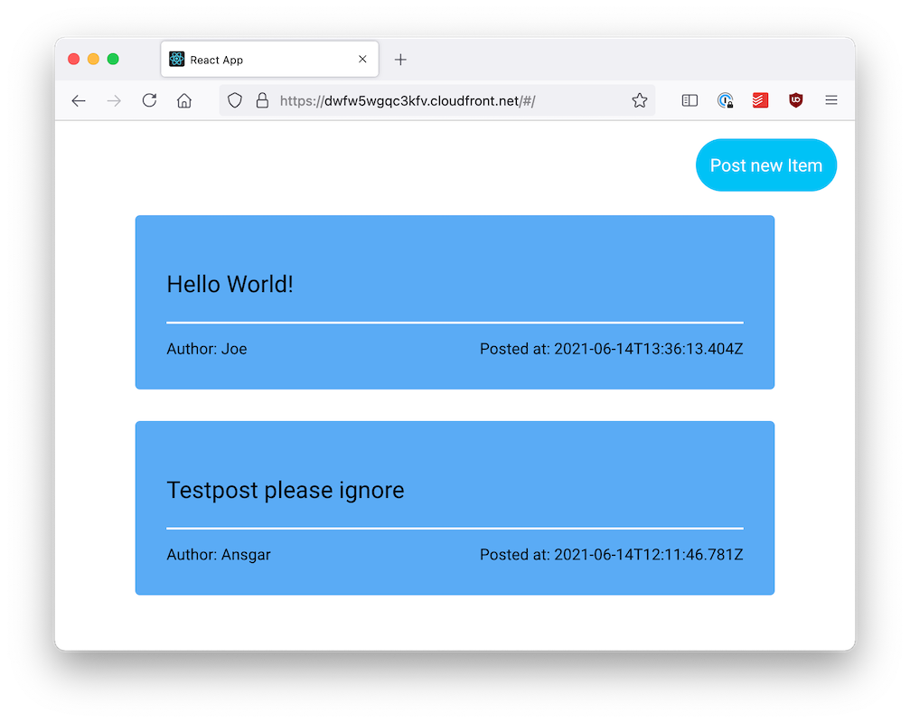
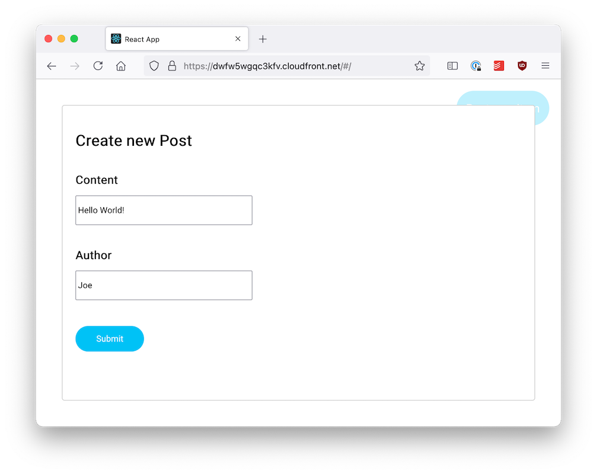

# The Future of Terraform CDK

## Sunset Notice

Terraform CDK (CDKTF) will sunset and be archived on December 10, 2025. HashiCorp, an IBM Company, will no longer maintain or develop the project after that date. Unfortunately, Terraform CDK did not find product-market fit at scale. HashiCorp, an IBM Company, has chosen to focus its investments on Terraform core and its broader ecosystem.

As of December 10, 2025, Terraform CDK will be archived on GitHub, and the documentation will reflect its deprecated status. The archived code will remain available on GitHub, but it will be read-only. No further updates, fixes, or improvements (including compatibility updates) will be made.

You will be able to continue to use Terraform CDK at your own risk. Terraform CDK is licensed under the Mozilla Public License (MPL). HashiCorp, an IBM Company, does not apply any additional restrictions. We encourage community forks if there’s interest in continuing development independently.

## Migration to HCL

You can use the following command to generate Terraform-compatible .tf files directly from your Terraform CDK project:

`cdktf synth --hcl`

This will produce readable HCL configuration files, making it easier to migrate away from Terraform CDK. After running the command, you can use standard Terraform CLI commands (`terraform init`, `terraform plan`, `terraform apply`) to continue managing your infrastructure. Please note that while this helps bootstrap your configuration, you may still need to review and adjust the generated files for clarity, organization, or best practices.

### Note on AWS CDK

If your infrastructure is defined in Terraform CDK but also tightly integrated with AWS CDK, you may find it more consistent to migrate directly to the AWS CDK ecosystem. If you are not using AWS CDK, we highly recommend migrating to standard Terraform and HCL for long-term support and ecosystem alignment.

## FAQ

Q: Is CDKTF still being developed?

A: No. CDKTF will sunset and be archived on December 10, 2025. HashiCorp, an IBM Company, will no longer maintain or develop the project after that date.

Q: Why is CDKTF being sunset?

A: CDKTF did not find product-market fit at scale. We’ve chosen to focus our investments on Terraform core and its broader ecosystem.

Q: Will CDKTF be removed from GitHub?

A: CDKTF will be archived on GitHub, and documentation will reflect its deprecated status.

Q: Can I still use CDKTF after it's sunset?

A: Yes, the archived code will remain available on GitHub, but it will be read-only. No further updates, fixes, or improvements will be made.

Q: Will CDKTF continue to support new versions of Terraform or providers?

A: No. Compatibility updates will not be made after the EOL date.

Q: Can I fork CDKTF and maintain it myself?

A: Yes. CDKTF is open source, and we encourage community forks if there’s interest in continuing development independently.

Q: Can I keep using CDKTF?

A: You may continue to use it at your own risk. HashiCorp, an IBM Company, will no longer be maintaining it.

Q: Is there a migration tool?

A: You can use the following command to generate Terraform-compatible .tf files directly from your CDKTF project:

`cdktf synth --hcl`

This will produce readable HCL configuration files, making it easier to migrate away from CDKTF. After running the command, you can use standard Terraform CLI commands (terraform init, terraform plan, terraform apply) to continue managing your infrastructure. Please note that while this helps bootstrap your configuration, you may still need to review and adjust the generated files for clarity, organization, or best practices.

Q: What migration guidance can we provide to customers?

A: For users looking to migrate away from CDKTF:

If your infrastructure is defined in CDKTF but also tightly integrated with AWS CDK, you may find it more consistent to migrate directly to the AWS CDK ecosystem.

If you are not using AWS CDK, we highly recommend migrating to standard Terraform and HCL for long-term support and ecosystem alignment.

---

# CDK for Terraform Serverless application example

This repo contains an end to end example in TypeScript for a serverless web application hosted on AWS and deployed with the [CDK for Terraform](https://cdk.tf). Please refer to the [guide](https://github.com/hashicorp/terraform-cdk/blob/main/docs/full-guide/serverless-application-typescript.md) for more information.

### Techstack

Frontend: React, Create React App, statically hosted via AWS S3 + CloudFront  
API: AWS Lambda + API Gateway + DynamoDB

### Application

The example application features a list of posts and a modal to create a new post by specifying author and content.

## Documentation

This application serves as the sample for the "Building a serverless application with the CDK for Terraform" guide which can be found [here](https://github.com/hashicorp/terraform-cdk/blob/main/docs/full-guide/serverless-application-typescript.md).

## Future Features

There are some features we'd like to add to this application over time to cover more common use cases and scenarios that might appear when building applications. As building within the serverless paradigm often makes use of cloud native services, we plan to extend this example to showcase such features and also to cover different cloud providers at some point.  
Besides new features, we also plan to keep this example up-to-date with newer versions of the CDKTF to get rid of workarounds for workflows that get supported by later versions of the CDKTF (e.g. referencing resource outputs in other stacks).

### Ideas

_(in no particular order)_

- [ ] Add a feature that makes use of a CRON job. This will probably be implemented using CloudWatch events for AWS as the "serverless way" of expressing such a feature.
- [ ] Give posts an optional expiration date after which they are deleted (if set). This will probably be implemented using the TTL functionality of DynamoDB (as opposed to a CRON which might have been used for cleanup in a traditional SQL database).
- [ ] Add a Github action to deploy preview builds to a temporary environment.
- [ ] Add tests on different levels (unit, integration, end-to-end, visual)
- [ ] Use an [Aspect](https://github.com/aws/constructs/blob/main/API.md#constructs-iaspect) (Visitor pattern) to set the environment prefix on all resources. Possibly also add a test that checks if all resources are covered (e.g. by using a random string and searching for its occurence in resource attributes).
- [ ] Use [IAM floyd](https://www.npmjs.com/package/iam-floyd) to build IAM policies in a more concise way
- [ ] Check if S3 Bucket could be restricted further. [Related](https://github.com/hashicorp/terraform-cdk/pull/786#issuecomment-864237132)

### Workarounds (required currently)

- cross stack references are defined manually (using Terraform remote state and Terraform outputs)

### Todos (short term)

- todo: extend npm scripts to deploy everything and feature commands to deploy to the different environments
- todo: write more docs about required AWS credentials and what the commands (from npm scripts) do

### Other notes (soon to be converted into issues for CDKTF)

- after renaming an asset, the previous output stays in cdktf.out/.../assets
- allow multiple stacks to be put into a single tf state?
- multiple stacks depedencies / order of deployment
- define dependencies between resources on a construct level without using inputs/outputs for terraform? -> i.e. could automatically add depends_on to resources
- multiple aws providers? (all being synthesized to the same tf stack but come from different constructs?)
- cdktf outputs --json command?
- detect if a "module" (= extends TerraformResource) adds an output that interferes with an existing output?
  -> this will probably fail because of the constructs name but we might want to improve the error message
